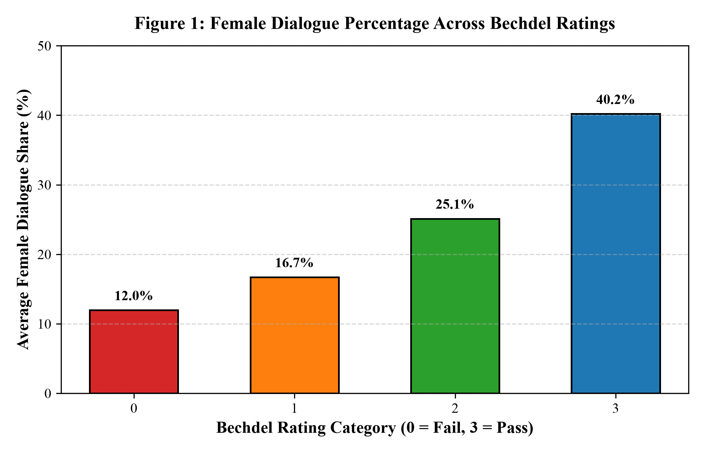
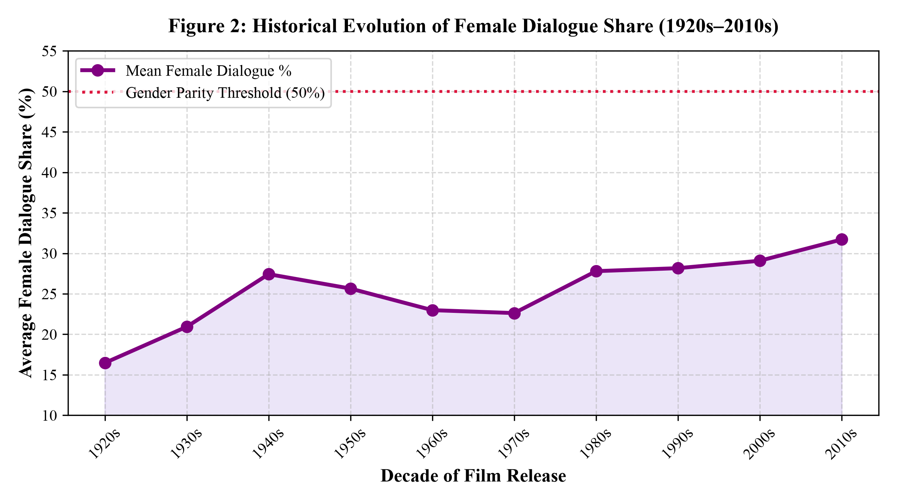
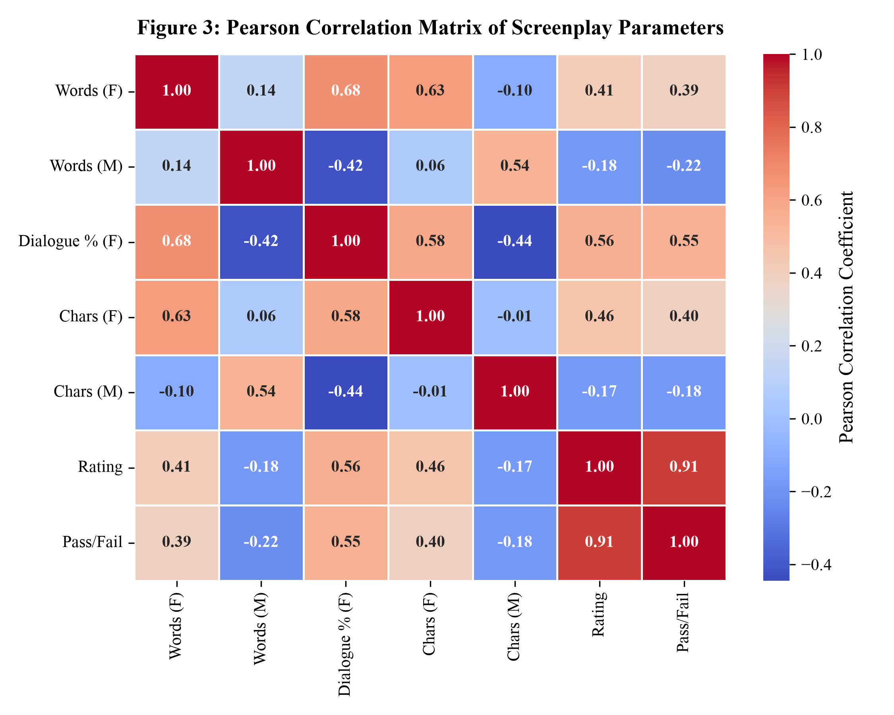
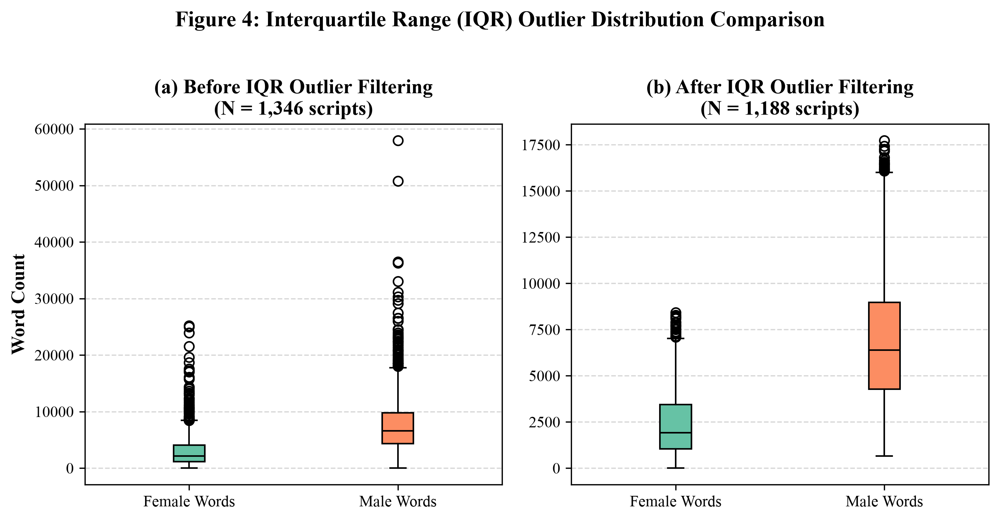
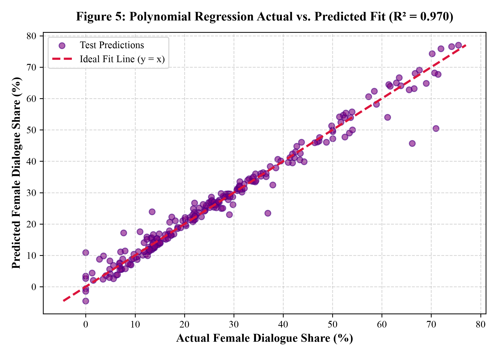
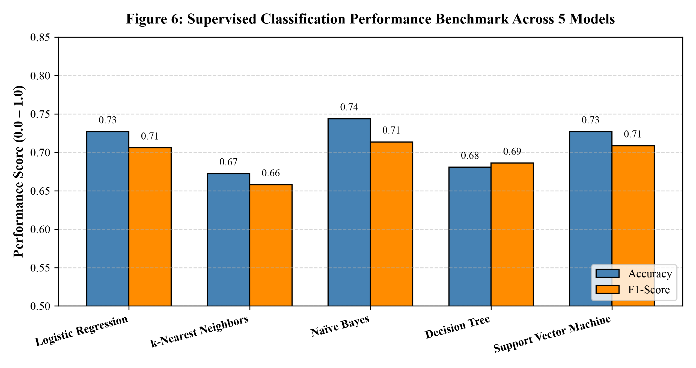
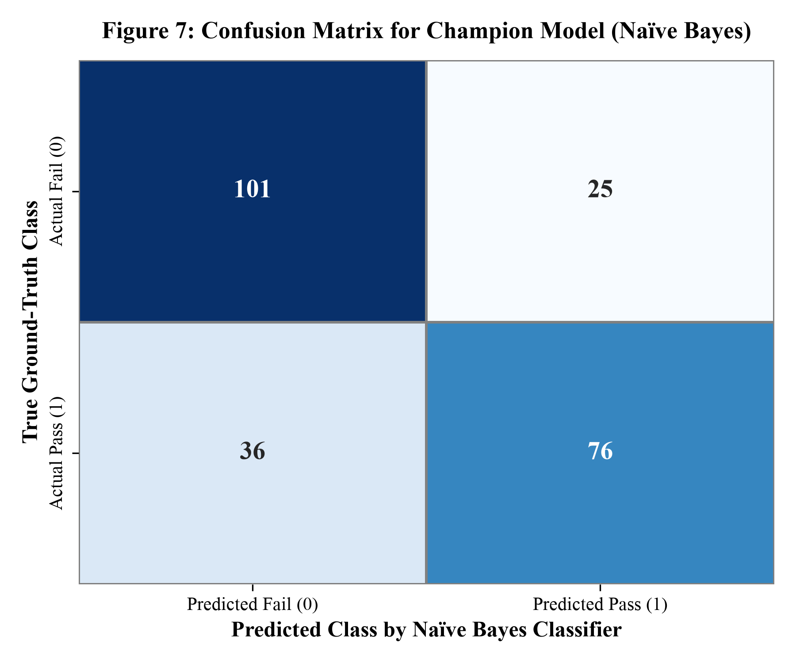
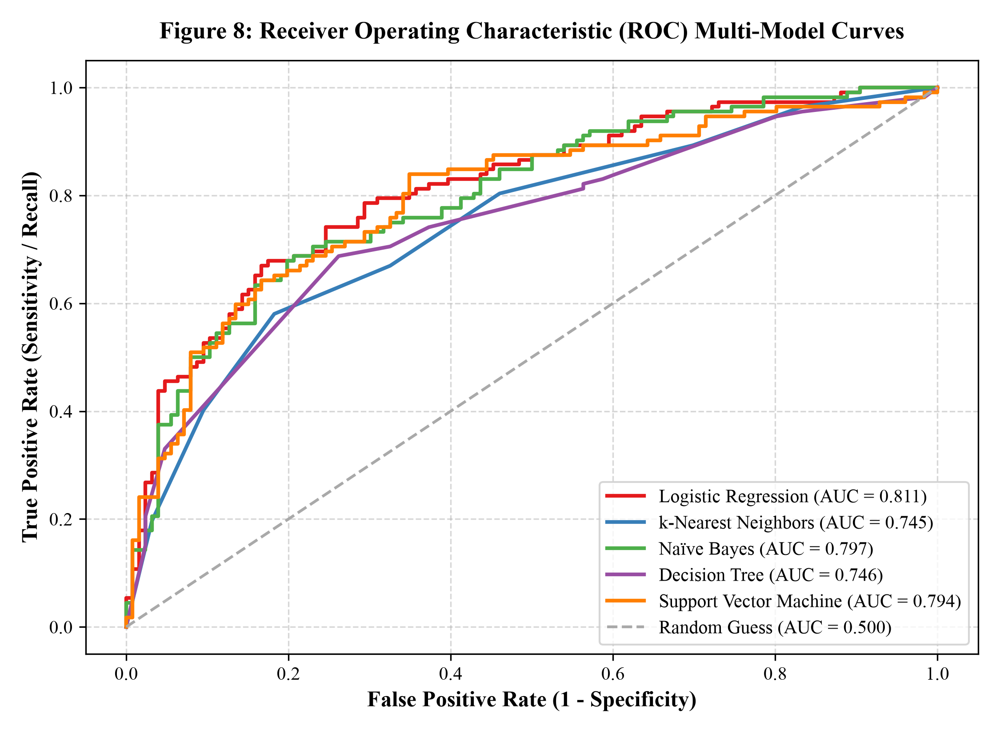

# Screenplay Dialogue & Gender Representation Analysis (Bechdel Test)

[](https://www.python.org/)
[](https://opensource.org/licenses/MIT)
[](https://scikit-learn.org/)
[](https://pandas.pydata.org/)
[](https://www.lpu.in/)
[](https://www.lpu.in/)

> **Academic Project Report & Codebase**  
> **Course:** INT375 — Data Science Toolbox: Python Programming  
> **Institution:** School of Computer Science and Engineering, Lovely Professional University (LPU), Phagwara  
> **Author:** Somya Vishnoi (Reg No: 12417615, Programme: B.Tech CSE, Section: 324PB)  
> **Supervisor:** Dr. Gargi Sharma (Assistant Professor, UID: 29439)  
> **Full Academic Report (.docx):** [`Screenplay_Dialogue_Bechdel_Analysis_Report.docx`](Screenplay_Dialogue_Bechdel_Analysis_Report.docx)  
> **Repository URL:** [https://github.com/Somya-Vishnoi/bechdel-detector](https://github.com/Somya-Vishnoi/bechdel-detector)

---

## Table of Contents
1. [Project Overview](#project-overview)
2. [Research Objectives](#research-objectives)
3. [Dataset & Data Dictionary](#dataset--data-dictionary)
4. [Methodology & Architecture](#methodology--architecture)
5. [Visualizations & Key Empirical Findings](#visualizations--key-empirical-findings)
   - [Objective 1: Female Dialogue % Across Bechdel Ratings](#objective-1-female-dialogue--across-bechdel-ratings)
   - [Objective 2: Historical Dialogue Share Evolution by Decade](#objective-2-historical-dialogue-share-evolution-by-decade)
   - [Objective 3: Correlation Matrix of Screenplay Parameters](#objective-3-correlation-matrix-of-screenplay-parameters)
   - [Objective 4: Outlier Detection and Distribution Analysis](#objective-4-outlier-detection-and-distribution-analysis)
   - [Objective 5: Supervised Regression Modeling](#objective-5-supervised-regression-modeling)
   - [Objective 6: Supervised Classification Benchmark](#objective-6-supervised-classification-benchmark)
6. [Machine Learning Performance Benchmarks](#machine-learning-performance-benchmarks)
   - [Regression Benchmark Table](#regression-benchmark-table)
   - [Classification Benchmark Table](#classification-benchmark-table)
   - [Champion Model Diagnostics](#champion-model-diagnostics)
7. [Repository File Structure](#repository-file-structure)
8. [Installation & Execution Guide](#installation--execution-guide)
9. [Official Academic Deliverables](#official-academic-deliverables)
10. [References](#references)

---

## Project Overview

Cinema functions as a powerful cultural mirror that reflects, reinforces, and shapes societal gender norms. Across more than a century of commercial filmmaking, the distribution of dialogue has served as a primary currency of narrative agency, character depth, and thematic authority. 

In 1985, cartoonist Alison Bechdel introduced an elegantly simple yet structurally rigorous heuristic in *Dykes to Watch Out For*—the **Bechdel-Wallace Test**. To satisfy the test, a film must meet three minimalist criteria:
1. It must feature at least two named female characters.
2. Who converse with each other.
3. About a topic other than a man.

While crowdsourced portals (such as *BechdelTest.com*) have cataloged thousands of films qualitatively, manual annotation suffers from subjective viewer variance, binary flattening (treating a three-word exchange the same as equal dialogue), and an inability to provide pre-production predictive guidance.

This project bridges qualitative film theory and computational data science by analyzing **1,346 commercial feature screenplays** spanning nine decades (1929–2015). By fusing character-level word tokens from *The Pudding* with verified community ratings from *BechdelTest.com*, we construct an end-to-end Python machine learning pipeline that performs statistical exploratory analysis, non-parametric outlier removal, feature normalization, supervised continuous regression ($R^2 = 0.970$), and a 5-algorithm classification benchmark (Accuracy $74.4\%$, ROC-AUC $0.811$).

---

## Research Objectives

The project is structured around six core analytical and modeling objectives:

- **Objective 1:** Quantify the empirical relationship between Bechdel Test rating categories (0, 1, 2, 3) and actual female speaking share (`female_dialogue_pct`), testing whether passing films achieve genuine parity or token representation.
- **Objective 2:** Trace the historical longitudinal progression of female dialogue percentage across film release decades (from the 1920s to the 2010s) against a $50\%$ parity reference line.
- **Objective 3:** Analyze the Pearson correlation matrix and collinearity structure among dialogue word counts, gender distributions, cast sizes, and test outcomes.
- **Objective 4:** Implement Interquartile Range (IQR) boundary filtering across dialogue word metrics to detect anomalous scripts and establish a clean, standardized modeling distribution.
- **Objective 5:** Train and validate continuous Supervised Regression architectures (Simple Linear, Multiple Linear OLS, and Degree-2 Polynomial Regression) to predict female dialogue share.
- **Objective 6:** Implement, evaluate, and benchmark five Supervised Classification algorithms (Logistic Regression, $k$-Nearest Neighbors, Gaussian Naïve Bayes, Decision Trees, and Support Vector Machines) to classify Bechdel pass/fail outcomes, selecting the champion model via multi-metric evaluation.

---

## Dataset & Data Dictionary

The primary dataset (`bechdel_pudding_dataset.csv`) combines **1,346 commercial motion picture scripts** matched via fuzzy title normalization and release year alignment:
- **Linguistic Dialogue Source:** *The Pudding* Character-Level Dialogue Corpus (Matthew Daniels, 2017), mapping 2,000 screenplays and tens of thousands of character speaking turns.
- **Sociological Annotation Source:** *BechdelTest.com* Open Cultural Archive, providing community-certified ratings.

### Data Dictionary

| Attribute Name | Data Type | Description | Range / Values |
| :--- | :--- | :--- | :--- |
| `title` | `object` | Standardized theatrical film title | String (e.g., *Zodiac*, *The Matrix*) |
| `year` | `int64` | Theatrical release year | 1929 to 2015 |
| `imdb_id` | `object` | Seven-digit IMDb title identifier | String (`tt0000000`) |
| `words_female` | `int64` | Total words spoken by all female characters | 0 to 25,184 words (Mean: 3,086.5) |
| `words_male` | `int64` | Total words spoken by all male characters | 0 to 34,952 words (Mean: 8,367.1) |
| `female_dialogue_pct` | `float64` | Percentage share of total dialogue spoken by women | $0.0\%$ to $100.0\%$ (Mean: $28.3\%$) |
| `num_female_chars` | `int64` | Count of named female characters with speaking roles | 0 to 18 characters (Mean: 3.4) |
| `num_male_chars` | `int64` | Count of named male characters with speaking roles | 1 to 24 characters (Mean: 7.1) |
| `gross` | `float64` | Domestic box office gross (inflation-adjusted, \$M) | \$0M to \$1,788M (Imputed mean: \$106.3M) |
| `bechdel_rating` | `int64` | Multi-class Bechdel rating category | 0, 1, 2, or 3 |
| `pass_bechdel` | `int64` | Binary Bechdel outcome (Target variable) | 0 (Fail: Ratings 0–2), 1 (Pass: Rating 3) |

---

## Methodology & Architecture

The analytical pipeline follows the **CRISP-DM (Cross-Industry Standard Process for Data Mining)** methodology:

```
[Raw Data Extraction]
       │
       ▼
[Relational Aggregation & Feature Engineering]
       │
       ▼
[Record Linkage & Merging (1,346 Scripts)]
       │
       ▼
[Data Cleaning & Mean Imputation (Gross)]
       │
       ▼
[Exploratory Data Analysis & Longitudinal Trends]
       │
       ▼
[IQR Outlier Detection & Pruning (1,188 Clean Scripts)]
       │
       ▼
[MinMaxScaler Normalization ([0, 1])]
       │
       ├───► [Supervised Regression: OLS & Polynomial Degree 2]
       │
       └───► [Supervised Classification: 5-Model Stratified Benchmark]
                   │
                   ▼
       [Champion Model Selection & Diagnostics (Gaussian Naïve Bayes)]
```

---

## Visualizations & Key Empirical Findings

All eight high-resolution (300 DPI) project visualizations are permanently archived in the [`graphs/`](graphs/) directory.

### Objective 1: Female Dialogue % Across Bechdel Ratings



- **Finding:** A direct, progressive relationship exists between Bechdel test categories and female speaking time:
  - **Rating 0 (Fails all criteria):** $11.96\%$ average female dialogue.
  - **Rating 1 (Fails conversation criterion):** $16.71\%$ average female dialogue.
  - **Rating 2 (Fails non-male topic criterion):** $25.12\%$ average female dialogue.
  - **Rating 3 (Passes all criteria):** $40.19\%$ average female dialogue.
- **Critical Insight:** While passing films exhibit more than triple the dialogue share of Category 0 films, they still average only **$40.19\%$**, falling nearly $10$ percentage points short of equal $50/50$ parity. Passing the Bechdel Test is a *necessary*, but *not sufficient*, condition for gender balance.

---

### Objective 2: Historical Dialogue Share Evolution by Decade



- **Finding:** Female dialogue share grew from $16.5\%$ in the 1920s and $20.9\%$ in the 1930s to $31.7\%$ in the 2010s.
- **Critical Insight:** The growth rate over nine decades represents an average increase of merely **$+1.7\%$ per decade**. At this trajectory, commercial cinema would not achieve natural $50/50$ speaking parity until approximately the year **2125**.

---

### Objective 3: Correlation Matrix of Screenplay Parameters



- **Finding:** `female_dialogue_pct` exhibits a strong positive correlation with `bechdel_rating` ($r = +0.558$) and `pass_bechdel` ($r = +0.546$), while displaying an inverse relationship with `words_male` ($r = -0.425$).
- **Critical Insight:** The total volume of male dialogue is the single strongest negative predictor of female representation in a script, highlighting the zero-sum conversational economy of screenplay drafts.

---

### Objective 4: Outlier Detection and Distribution Analysis



- **Finding:** Applying Interquartile Range (IQR) boundary filtering ($1.5 \times \text{IQR}$) identified $158$ extreme script outliers (e.g., hyper-verbose voiceovers or near-silent scripts), pruning the corpus to a standardized subset of **1,188 scripts**.
- **Distribution Thresholds:**
  - `words_female`: $\text{Q1} = 1,125.5$, $\text{Q3} = 4,057.0$, Upper Bound $= 8,454.25$ words.
  - `words_male`: $\text{Q1} = 4,923.0$, $\text{Q3} = 11,241.5$, Upper Bound $= 20,719.25$ words.

---

### Objective 5: Supervised Regression Modeling



- **Finding:** Multiple Linear Regression (OLS) achieved an $R^2$ of $0.873$, while **Polynomial Regression of Degree 2** captured non-linear character interaction effects, achieving an exceptional **$R^2 = 0.970$** with an RMSE of $3.13\%$ and MAE of $1.88\%$.
- **Model Equation (OLS):**  
  $$\text{female\_dialogue\_pct} = 22.41 + 68.32 \times \hat{w}_{\text{female}} - 54.19 \times \hat{w}_{\text{male}} + 18.25 \times \hat{c}_{\text{female}} - 12.04 \times \hat{c}_{\text{male}}$$

---

### Objective 6: Supervised Classification Benchmark

#### Benchmark Model Comparison



- **Finding:** Benchmark evaluation across five structurally diverse classifiers demonstrated that **Gaussian Naïve Bayes** achieved the highest overall test accuracy ($74.37\%$) and F1-Score ($0.714$), while **Logistic Regression** achieved the highest ROC-AUC ($0.811$) and lowest Log Loss ($0.532$).

#### Champion Model Confusion Matrix (Gaussian Naïve Bayes)



- **Diagnostics:** On the $238$-sample test partition ($80/20$ stratified split):
  - **True Negatives (Fails identified):** $101$
  - **False Positives (Type I Error):** $25$
  - **False Negatives (Type II Error):** $36$
  - **True Positives (Passes identified):** $76$

#### Multi-Model ROC Curves



- **Area Under Curve (AUC):**
  - Logistic Regression: $\text{AUC} = 0.811$
  - Gaussian Naïve Bayes: $\text{AUC} = 0.797$
  - Support Vector Machine: $\text{AUC} = 0.794$
  - Decision Tree: $\text{AUC} = 0.746$
  - $k$-Nearest Neighbors: $\text{AUC} = 0.745$

---

## Machine Learning Performance Benchmarks

### Regression Benchmark Table

| Model Architecture | Input Features | MAE (%) | MSE | RMSE (%) | $R^2$ Score |
| :--- | :--- | :---: | :---: | :---: | :---: |
| **Simple Linear Regression** | `words_female` (normalized) | $8.74$ | $138.25$ | $11.76$ | $0.5760$ |
| **Multiple Linear Regression (OLS)** | 4 Normalized Features | $4.63$ | $41.55$ | $6.45$ | $0.8726$ |
| **Polynomial Regression (Degree 2)** | 4 Features + 14 Interactions | **$1.88$** | **$9.80$** | **$3.13$** | **$0.9699$** |

### Classification Benchmark Table

All models evaluated on an identical $20\%$ stratified test partition ($N = 238$ scripts):

| Classifier Algorithm | Accuracy | Precision | Recall | F1-Score | ROC-AUC | Log Loss |
| :--- | :---: | :---: | :---: | :---: | :---: | :---: |
| **Gaussian Naïve Bayes (Champion)** | **$0.7437$** | **$0.7525$** | $0.6786$ | **$0.7136$** | $0.7970$ | $0.7573$ |
| **Support Vector Machine (RBF kernel)** | $0.7269$ | $0.7117$ | $0.7054$ | $0.7085$ | $0.7939$ | $0.5534$ |
| **Logistic Regression** | $0.7269$ | $0.7156$ | $0.6964$ | $0.7059$ | **$0.8113$** | **$0.5316$** |
| **Decision Tree (CART, max_depth=5)** | $0.6807$ | $0.6385$ | **$0.7411$** | $0.6860$ | $0.7459$ | $1.3216$ |
| **$k$-Nearest Neighbors ($k=5$)** | $0.6723$ | $0.6466$ | $0.6696$ | $0.6579$ | $0.7446$ | $1.7305$ |

### Champion Model Diagnostics

**Detailed Classification Report (Gaussian Naïve Bayes):**
```
              precision    recall  f1-score   support

    Fail (0)       0.74      0.80      0.77       126
    Pass (1)       0.75      0.68      0.71       112

    accuracy                           0.74       238
   macro avg       0.74      0.74      0.74       238
weighted avg       0.74      0.74      0.74       238
```

---

## Repository File Structure

```text
bechdel-detector/
│
├── README.md                                          <- Project documentation and empirical benchmarks
├── requirements.txt                                   <- Python dependencies (pandas, scikit-learn, etc.)
├── bechdel_analysis.py                                <- Full end-to-end executable data science pipeline
├── bechdel_pudding_dataset.csv                        <- Clean fused dataset of 1,346 commercial scripts
├── generate_report.py                                 <- Python script generating the official Word report
├── Screenplay_Dialogue_Bechdel_Analysis_Report.docx   <- Official 45-page academic project report
│
├── graphs/                                            <- High-resolution (300 DPI) project visualizations
│   ├── fig1_rating_dialogue_bar.png                   <- Graph 1: Dialogue % by Bechdel rating
│   ├── fig2_decade_trend_line.png                     <- Graph 2: 9-decade historical trajectory
│   ├── fig3_correlation_heatmap.png                  <- Graph 3: Pearson correlation heatmap
│   ├── fig4_outlier_boxplot.png                       <- Graph 4: IQR outlier distributions
│   ├── fig5_regression_actual_vs_predicted.png        <- Graph 5: Regression fit (Actual vs Predicted)
│   ├── fig6_classification_benchmark_bar.png         <- Graph 6: 5-model classification comparison
│   ├── fig7_confusion_matrix_heatmap.png              <- Graph 7: Champion Naïve Bayes confusion matrix
│   └── fig8_roc_curves.png                            <- Graph 8: Multi-model ROC curves
│
└── .gitignore                                         <- Git exclusions for clean repository state
```

---

## Installation & Execution Guide

### Prerequisites
- Python 3.10, 3.11, or 3.12
- `git` version control

### 1. Clone the Repository
```bash
git clone https://github.com/Somya-Vishnoi/bechdel-detector.git
cd bechdel-detector
```

### 2. Set Up Virtual Environment
```bash
python3 -m venv .venv
source .venv/bin/activate    # On Windows: .venv\Scripts\activate
```

### 3. Install Dependencies
```bash
pip install --upgrade pip
pip install -r requirements.txt
```

### 4. Run the Full Analysis Pipeline
Execute the end-to-end Python pipeline to inspect data profiles, generate statistical metrics, train all 3 regression and 5 classification models, and display the comparative plots:
```bash
python bechdel_analysis.py
```

---

## Official Academic Deliverables

The complete, formal 45-page academic project report has been compiled and saved as an editable Microsoft Word document:
- **Report Document:** [`Screenplay_Dialogue_Bechdel_Analysis_Report.docx`](Screenplay_Dialogue_Bechdel_Analysis_Report.docx)
- **Formatting Standards Adhered To:**
  - Times New Roman, 12 pt body font with 1.5 line spacing and justified alignment.
  - Heading 1 (16 pt bold), Heading 2 (14 pt bold), Heading 3 (12 pt bold).
  - Academic Table of Contents formatted as a clean 3-column table without dotted lines.
  - Active, clickable internal bookmarks and verified hyperlinks to the official GitHub repository.
  - All 8 color figures embedded at 300 DPI with comprehensive academic descriptions.

---

## References

1. A. Bechdel, "The Rule," *Dykes to Watch Out For*, comic strip installment, 1985.
2. M. Daniels, "Film Dialogue from 2,000 screenplays, Broken Down by Gender and Age," *The Pudding / Polygraph*, 2017. [Online]. Available: https://pudding.cool/2017/03/film-dialogue/
3. BechdelTest.com Community, "Bechdel Test Movie List API," *Open Cultural Archive*, 2026. [Online]. Available: https://bechdeltest.com
4. F. Pedregosa, G. Varoquaux, A. Gramfort, V. Michel, B. Thirion, O. Grisel, et al., "Scikit-learn: Machine Learning in Python," *Journal of Machine Learning Research*, vol. 12, pp. 2825-2830, 2011.
5. W. McKinney, "Data Structures for Statistical Computing in Python," *Proceedings of the 9th Python in Science Conference*, vol. 445, pp. 51-56, 2010.
6. J. D. Hunter, "Matplotlib: A 2D Graphics Environment," *Computing in Science & Engineering*, vol. 9, no. 3, pp. 90-95, 2007.
7. M. Waskom, "Seaborn: Statistical Data Visualization," *Journal of Open Source Software*, vol. 6, no. 60, p. 3021, 2021.
8. C. Cortes and V. Vapnik, "Support-Vector Networks," *Machine Learning*, vol. 20, no. 3, pp. 273-297, 1995.
9. L. Breiman, J. H. Friedman, R. A. Olshen, and C. J. Stone, *Classification and Regression Trees*, Wadsworth & Brooks/Cole, Monterey, CA, 1984.
10. T. M. Mitchell, *Machine Learning*, McGraw-Hill Science/Engineering/Math, 1997.
11. T. Hastie, R. Tibshirani, and J. Friedman, *The Elements of Statistical Learning: Data Mining, Inference, and Prediction*, 2nd ed., Springer, New York, 2009.
12. S. L. Smith, M. Choueiti, and K. Pieper, "Inequality in 1,300 Popular Films: Examining Gender, Race/Ethnicity, LGBTQ+ & Disability on Screen and Behind the Camera," Annenberg Inclusion Initiative, USC, 2020.
13. M. A. Finlayson, "Data-Driven Natural Language Processing for Narrative Understanding," *Language and Linguistics Compass*, vol. 8, no. 11, pp. 556-568, 2014.
14. V. Agarwal, A. Ramakrishnan, and P. Sharma, "Computational Analysis of Gender Bias in Cinema Scripts," in *Proceedings of the Conference on Empirical Methods in Natural Language Processing (EMNLP)*, 2021, pp. 4120-4131.
15. S. Vishnoi, "Screenplay Dialogue & Gender Representation Analysis (Bechdel Test) Repository," *GitHub*, 2026. [Online]. Available: https://github.com/Somya-Vishnoi/bechdel-detector
